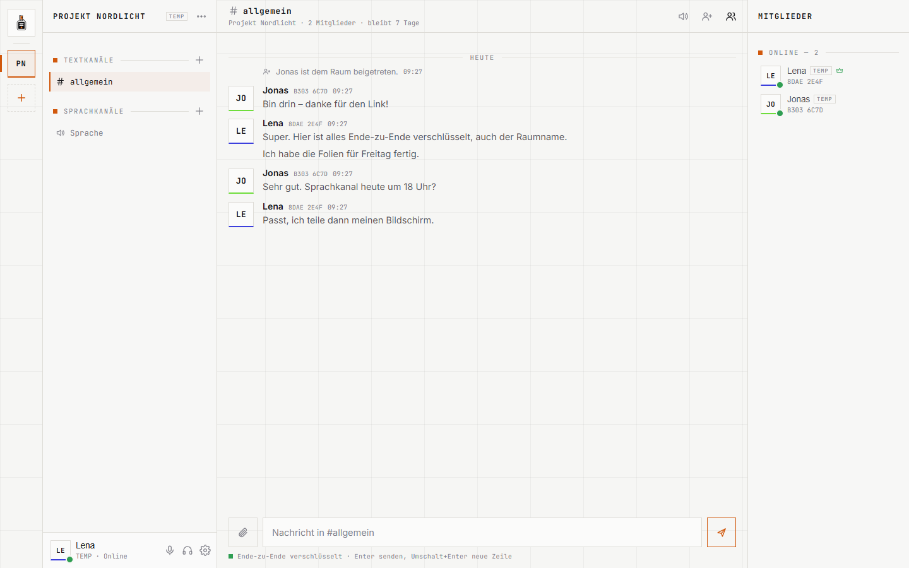
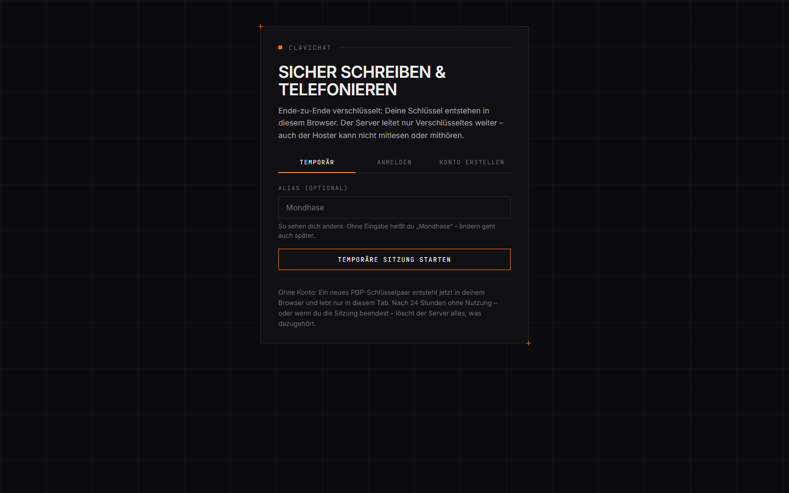
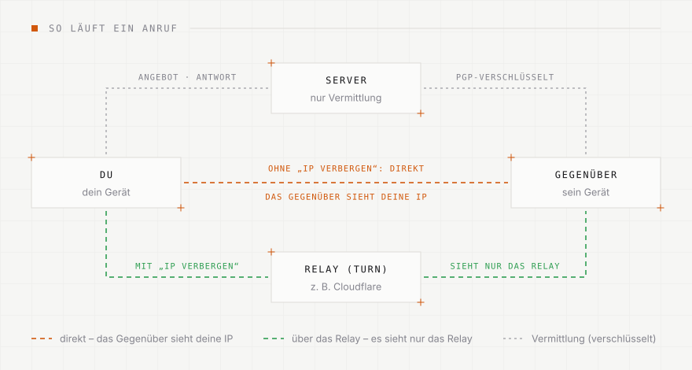
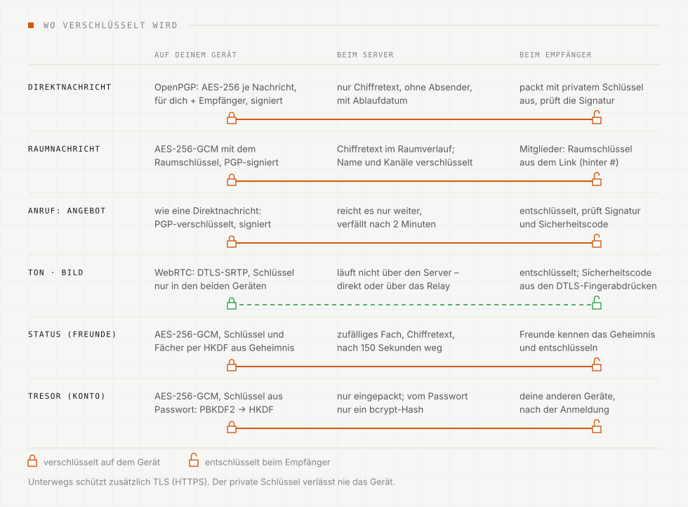
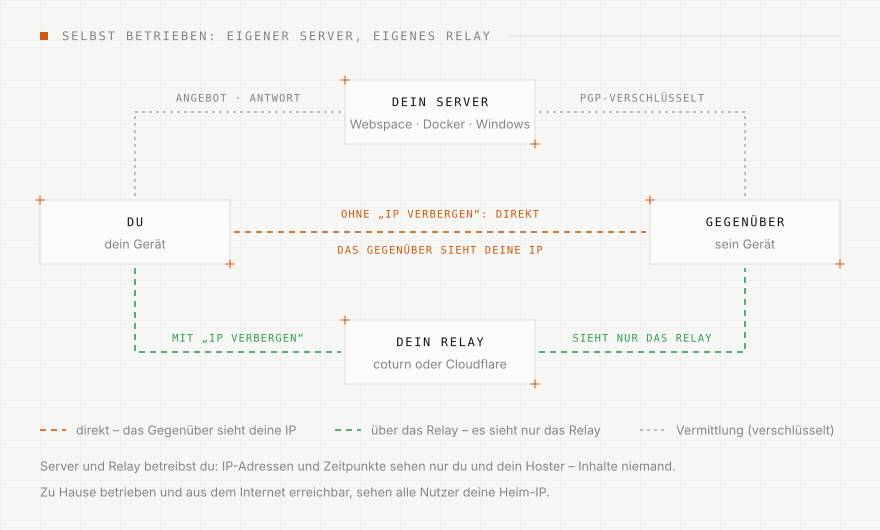

<div align="center">


# Clavichat

**Ende-zu-Ende verschlüsselt schreiben, telefonieren und den Bildschirm teilen –
im Browser oder als Windows-App.**

[clavichat.de](https://clavichat.de) ·
[Windows-App](https://github.com/mxachterberg/clavichat/releases) ·
[Sicherheit](SECURITY.md) ·
[Änderungen](CHANGELOG.md)

</div>

Der Server speichert und verteilt nur Chiffretext, öffentliche Schlüssel und
Signaturen.

<picture>
  <source media="(prefers-color-scheme: dark)" srcset="docs/screenshot-chat-dunkel.png">
  
</picture>

<details>
<summary>Startseite</summary>



</details>

> **English:** Clavichat is an end-to-end encrypted messenger with voice and
> video calls and screen sharing, built on OpenPGP.js, WebCrypto and WebRTC.
> The PHP server needs no database and only ever handles ciphertext. The
> Windows app (Electron) ships the client code itself, so the server cannot
> swap it. Documentation is in German; the crypto design is in
> [SECURITY.md](SECURITY.md).

## Was es kann

- **Ohne E-Mail:** Konto mit Name und Passwort – oder eine temporäre Sitzung,
  für die der Browser ein frisches PGP-Schlüsselpaar erzeugt. Wahlweise mit
  Alias. Eigene PGP-Schlüssel (GnuPG, Kleopatra) lassen sich übernehmen und mit
  Passphrase gesichert exportieren. Konten können ein Profilbild festlegen.
- **Freunde:** per öffentlichem Schlüssel oder Fingerabdruck hinzufügen;
  nach der Annahme seht ihr gegenseitig euren Status (Online, Beschäftigt,
  Abwesend – nach 10 Minuten ohne Eingabe von selbst – oder „Als offline
  anzeigen“). Verschlüsselt: Der Server weiß nicht, wer mit wem befreundet
  ist.
- **Wer ist da:** Online-Liste mit Alias und Fingerabdruck – nur für
  temporäre Sitzungen. Konten zeigen ihren Status nur Freunden.
- **Schreiben:** Direktnachrichten und Räume mit Textkanälen und Raumbild.
  Einladung per Link oder direkt (nur Besitzer und Administratoren); wer den
  Raum verlässt oder entfernt wird, löst einen neuen Raumschlüssel aus. Wie lange Nachrichten bleiben, legt
  jede Unterhaltung fest (1 Stunde bis 30 Tage, Standard 7 Tage) – danach
  löscht sie der Server.
- **Reagieren** mit zwölf eigenen Symbolen (Rechtsklick oder Knopf an der
  Nachricht) – in Räumen und Direktnachrichten, verschlüsselt wie die
  Nachrichten selbst.
- **Ränge und Rechte** wie bei Discord: Ränge mit Farbe und Rechten
  (Kanäle, Raum, Nachrichten, Mitglieder, API-Zugänge, Ränge verwalten,
  Administrator), Rangordnung, Vorlagen; je Kanal festlegen, wer schreiben
  bzw. einen Sprachkanal betreten darf (Rechtsklick auf den Kanal). Die
  Raumschlüssel bleiben beim Besitzer.
- **Dateien und Bilder** bis 25 MB, Ende-zu-Ende verschlüsselt mit eigenem
  Schlüssel je Datei; Bilder ohne Metadaten (etwa den Aufnahmeort), mit
  Vorschau. Per Büroklammer, Hereinziehen oder Einfügen.
- **Nachrichtenanfragen:** Wer zum ersten Mal schreibt, landet erst dort –
  ohne Ton, Links nur als Text, Dateien und Einladungen gesperrt, Anrufe von
  Unbekannten klingeln bei Konten nicht.
- **Forward Secrecy:** Der Schlüssel für Nachrichten an dich wechselt jede
  Woche, alte werden gelöscht; in Räumen wechselt der Besitzer den
  Raumschlüssel wöchentlich.
- **Geräte und Sperre:** angemeldete Geräte sehen und aus der Ferne abmelden,
  Hinweis bei neuer Anmeldung; App-Sperre mit PIN (nach Leerlauf, beim
  Sperren von Windows, Strg+L), die gespeicherte Anmeldung nur mit PIN
  verschlüsselt – in der Windows-App zusätzlich an das Windows-Konto
  gebunden. Schutz vor Bildschirmfotos (Windows-App).
- **Sprechen und zeigen:** Sprach- und Videoanrufe in wählbarer Tonqualität
  (bis 128 kbit/s in Stereo; in Räumen auf Wunsch für alle festgelegt),
  mehrere Sprachkanäle je Raum (je bis 8 Personen), Bildschirm teilen in
  wählbarer Qualität (von „Sparsam“ bis „Quelle“: Originalauflösung mit
  60 fps, auch während der Übertragung) – in der Windows-App auch mit dem Ton
  des Computers. Zuschauer können bis zehnfach hineinzoomen, die Werte der
  Übertragung sehen oder sie ausblenden. Verbindungsqualität und ein
  Sicherheitscode stehen oben rechts.
- **Benachrichtigungen** nennen nur Absender oder Anrufer, nie den Inhalt.
- **Kleinigkeiten:** Unterhaltungen und Kanäle per Rechtsklick (Handy: lange
  drücken) als gelesen markieren, umbenennen oder löschen; temporäre
  Sitzungen ohne Alias bekommen einen Zufallsnamen; nach einem Anruf steht
  die Dauer im Verlauf.

## So funktioniert Clavichat

Ver- und entschlüsselt wird nur auf den Geräten; der Server vermittelt und
speichert, sieht aber nur Chiffretext. Ein Anruf nimmt zwei Wege: Das
Verbindungsangebot läuft PGP-verschlüsselt über den Server, Ton und Bild
direkt zwischen den Geräten – oder mit „IP verbergen“ über ein Relay, dann
sieht das Gegenüber die eigene IP-Adresse nie.

<picture>
  <source media="(prefers-color-scheme: dark)" srcset="docs/anruf-dunkel.svg">
  
</picture>

Wo und womit verschlüsselt wird – auf dem eigenen Gerät, beim Server und
beim Empfänger:

<picture>
  <source media="(prefers-color-scheme: dark)" srcset="docs/verschluesselung-dunkel.svg">
  
</picture>

In der App zeigt „So funktioniert’s“ dieselben Grafiken zum Ausprobieren
(mit Schalter für „IP verbergen“). Die Bilder hier entstehen mit
`node docs/diagramme.mjs`.

## So schützt Clavichat

| Was | Wie |
|---|---|
| Identität | OpenPGP-Schlüsselpaar (Ed25519 signiert, X25519 verschlüsselt), entsteht im Browser |
| Direktnachrichten, Anruf-Signale | OpenPGP (RFC 9580): neuer AES-256-Schlüssel pro Nachricht, für Empfänger und Absender eingepackt, AEAD (OCB), signiert |
| Räume | gemeinsamer Raumschlüssel, AES-256-GCM, jede Nachricht zusätzlich signiert; Name, Kanäle und Raumbild ebenfalls verschlüsselt. Im Einladungslink steht der Schlüssel hinter dem `#` und geht nie an einen Server |
| Profilbilder | nur Konten, öffentlich wie der Name; die signierte Karte nennt den SHA-256-Wert, angezeigt wird nur ein passendes Bild |
| Anrufe, Bildschirm | WebRTC direkt zwischen den Geräten (DTLS-SRTP). Verbindungsangaben signiert und verschlüsselt, Sicherheitscode aus den DTLS-Fingerabdrücken |
| Konten | PBKDF2-SHA-256 (600.000 Runden) → HKDF → Anmeldeschlüssel (beim Server nur als bcrypt-Hash) und ein Schlüssel, der den privaten PGP-Schlüssel einpackt |
| Freunde, Status | gemeinsames Geheimnis aus der PGP-verschlüsselten Anfrage → HKDF → zwei zufällige Fächer beim Server und ein AES-256-GCM-Schlüssel; der Server sieht weder Status noch Freundschaften |
| Aufbewahrung | Ablaufdatum je Nachricht beim Server (Standard 7 Tage); verkürzt eine Unterhaltung, löscht jede Seite ihre älteren Einträge; Abgelaufenes wird stündlich gelöscht. Räume eines Kontos auch „Permanent“: nichts verfällt nach Zeit (Verlauf höchstens `securecom_permanent_mb`, Standard 16 MB – dann fallen die ältesten weg), alte Raumschlüssel bleiben dafür erhalten. Einzelne Textkanäle können eine eigene Aufbewahrung haben (der Server erfährt dann nur deren zufällige Kennung) |
| Forward Secrecy | wöchentlich neuer X25519-Unterschlüssel, alte nach Aufbewahrung + 2 Tagen gelöscht; Raumschlüssel wöchentlich neu, alte Generationen gelöscht |
| Dateien | eigener AES-256-GCM-Schlüssel je Datei, 512-KiB-Stücke (Reihenfolge und Anzahl authentifiziert); Schlüssel nur in der verschlüsselten Nachricht; Bilder ohne Metadaten |
| Auf dem Gerät | App-Sperre: PIN → PBKDF2 (600.000 Runden) → AES-256-GCM versiegelt die gespeicherte Anmeldung; Windows-App zusätzlich DPAPI |
| Updates (Windows-App) | Update-Liste mit Ed25519 signiert, Datei mit SHA-256 geprüft; der Signaturschlüssel liegt nur beim Herausgeber |
| API-Zugänge | nur posten: ECDH P-256 + HKDF-SHA-256 + AES-256-GCM an den Schlüssel des Zugangs, gebunden an Raum und Zugang; beim Server nur der Hash des Tokens |
| Länge | jeder Klartext wird vor dem Verschlüsseln auf feste Größen aufgefüllt |

Details, Grenzen und was der Server trotzdem sieht: [SECURITY.md](SECURITY.md).

## Aufbau

```
server/            PHP-Server ohne Datenbank, dazu die Web-Oberfläche
  index.php        die Seite
  api.php          einzige Schnittstelle (nur POST, JSON)
  lib/             Server-Logik (SecureCom.php, util.php)
  assets/          Oberfläche: securecom.js, Kryptografie in securecom-core.js,
                   OpenPGP.js unter vendor/, Schriften unter fonts/
  router.php       Weiche für den eingebauten PHP-Server (php -S)
desktop/           Windows-App (Electron), nimmt die Oberfläche aus server/assets
  host/            Clavichat Server für Windows: PHP + HTTPS als Programm
Dockerfile         Server als Container (Apache + PHP)
compose.yaml       Container samt Caddy für HTTPS – für einen eigenen Server
docker/            Einstellungen für den Container
tests/e2e.mjs      Ende-zu-Ende-Test gegen einen laufenden Server
tools/             clavichat-post.mjs: Beiträge über einen API-Zugang (ohne Abhängigkeiten)
```

Kein Build-Schritt für die Web-Fassung: Die Oberfläche ist reines JavaScript
(ES-Module), der Server reines PHP.

## Beiträge per API (nur posten)

Skripte – oder Claude – posten über einen **API-Zugang** in einen Textkanal,
etwa Server-Neuigkeiten in `#servernews`. Den Zugang legt der Besitzer des
Raums an (Raum-Menü → EINSTELLUNGEN → API-Zugang: Name und Kanal; nur Konten,
nicht in Meetings oder temporären Räumen, höchstens fünf je Raum). Er wird
genau einmal angezeigt und lässt sich dort jederzeit widerrufen.

```sh
# Node 18 oder neuer, ohne Abhängigkeiten
node tools/clavichat-post.mjs "clavichat-hook:1:…" "Wartung heute um 22 Uhr"
echo "Backup fertig" | CLAVICHAT_HOOK="clavichat-hook:1:…" node tools/clavichat-post.mjs
```

Über `CLAVICHAT_HOOK` steht der Zugang weder im Verlauf der Shell noch in der
Prozessliste. Ins Repository, in Logs oder Tickets gehört er nicht – wer ihn
hat, kann in den Kanal posten.

Warum der Zugang nichts lesen kann: Er enthält nur Server-Adresse, Raum,
Kennung, ein zufälliges Token und einen **öffentlichen** Schlüssel. Das
Werkzeug verschlüsselt jeden Beitrag selbst (frischer ECDH-Schlüssel →
HKDF → AES-256-GCM, an Raum und Zugang gebunden); der passende private
Schlüssel steht nur in den verschlüsselten Raumdaten der Mitglieder. Der
Server kennt vom Token nur den SHA-256-Wert, nimmt es ausschließlich für
`hook.post` an (Größe höchstens 16 KB, je Zugang 20 Beiträge pro Minute und 300 pro Stunde) und
liefert darauf nichts zurück – keinen Verlauf, keine Mitglieder, keinen
Raumschlüssel. Die Beiträge erscheinen mit dem Namen des Zugangs und dem
Zeichen „API“; ältere Apps (bis 1.8.8) blenden sie aus.

Den privaten Schlüssel kennen alle Mitglieder – auch ehemalige – und wer einen
gültigen Einladungslink hat. Er wechselt nicht mit dem Raumschlüssel. Nach dem
Gehen eines Mitglieds deshalb im selben Dialog **„Zugänge erneuern“**: neue
Schlüssel und Tokens, die alten posten nicht mehr (neu in den Skripten
eintragen). Details in [SECURITY.md](SECURITY.md#api-zugänge).

## Eigenen Server einrichten

Selbst betrieben läuft alles wie auf clavichat.de – nur gehören Server und
Relay dir. Die Verschlüsselung ändert sich nicht; IP-Adressen und Zeitpunkte
sehen dann nur du und dein Hoster.

<picture>
  <source media="(prefers-color-scheme: dark)" srcset="docs/anruf-selbst-dunkel.svg">
  
</picture>

Gebraucht wird ein Webspace mit **PHP 8** (getestet mit 8.3), **HTTPS** und
Apache. Keine Datenbank, kein Composer; die PHP-Erweiterung `curl` nur für
Cloudflare-TURN.

1. Den Inhalt von `server/` hochladen, zum Beispiel nach `/clavichat/`.
2. Optional `config.sample.php` als `config.php` speichern und anpassen. Am
   wichtigsten: `storage_dir` **außerhalb** des Webroots.
3. Ohne `storage_dir` legt Clavichat `storage/` neben `api.php` an und sperrt
   den Ordner per `.htaccess`. PHP muss dort schreiben dürfen (Ordner 755,
   Dateien 644, nie 777).
4. `https://example.com/clavichat/` aufrufen.

**nginx** liest keine `.htaccess`. Dann selbst sperren: `lib/`, `storage/`,
`config.php` und Dateien mit den Endungen `.json`, `.jsonl`, `.key`, `.md`,
`.log`.

**Anrufe über Mobilfunk** brauchen oft einen Relay-Server (TURN), weil sich
die Geräte sonst nicht direkt erreichen. In `config.php` entweder einen eigenen
eintragen (`securecom_turn`) oder Cloudflare Realtime TURN (`securecom_cf_turn`).
Mit TURN funktioniert auch die Einstellung „IP-Adresse verbergen“ (bei
temporären Sitzungen von Haus aus an): Das Gegenüber sieht dann nur das
Relay, nie die eigene IP. Die
Zugangsdaten bekommen nur angemeldete Sitzungen, damit niemand Fremdes das
TURN-Kontingent nutzt.

Außerdem in `config.sample.php`: Zugangscode für neue Konten, wie lange
Nachrichten liegen bleiben, Lebensdauer temporärer Sitzungen, Obergrenze der
Identitäten. Hinter einem Reverse-Proxy dessen Adresse unter `trusted_proxies`
eintragen – sonst teilen sich alle Besucher eine Adresse und damit die
Rate-Limits.

## Server unter Windows

Ohne Webspace, etwa für das Heimnetz: **Clavichat Server** startet den Server
per Doppelklick (Installer oder portable Fassung unter
[Releases](https://github.com/mxachterberg/clavichat/releases)). PHP ist dabei,
einrichten muss man nichts.

- Das Fenster zeigt die Adressen, etwa `https://192.168.1.10:8443/`. Andere
  Geräte im Heimnetz öffnen sie im Browser; Windows fragt beim ersten Start
  nach der Firewall („Private Netzwerke“ erlauben).
- HTTPS mit einem selbst erstellten Zertifikat – Browser geben Verschlüsselung
  und Mikrofon nur über HTTPS frei. Beim ersten Aufruf warnt der Browser
  einmal; der Fingerabdruck im Fenster zeigt, ob es das richtige Zertifikat ist.
- Läuft im Hintergrund weiter (Symbol im Infobereich), auf Wunsch mit Windows.
- Daten und Einstellungen liegen in `%APPDATA%\Clavichat Server`: `data` und
  `config.php` (Zugangscode, Relay-Server). Ein Update ändert daran nichts.
- Gedacht fürs Heimnetz. Von außen per Portweiterleitung erreichbar machen
  rate ich ab: Dann sieht jeder, der die Adresse aufruft oder anruft, die
  IP-Adresse deines Anschlusses zu Hause. Für Nutzung übers Internet besser
  einen Webspace oder gemieteten Server nehmen – siehe oben und unten.

## Docker

```
docker compose up -d
```

`compose.yaml` startet Clavichat (Apache + PHP) und davor Caddy, das sich um
HTTPS kümmert. Am besten auf einem gemieteten Server (VPS). Zu Hause betrieben
und aus dem Internet erreichbar, zeigt die Domain auf deinen Anschluss – wer
Clavichat dort nutzt, sieht deine Heim-IP. Nur im Heimnetz ist das egal.

Die Adresse steht in `SECURECOM_SITE` (in einer `.env`-Datei
daneben oder in der Shell):

| `SECURECOM_SITE` | HTTPS |
|---|---|
| `chat.example.com` | Zertifikat von Let's Encrypt (Ports 80/443 müssen von außen erreichbar sein) |
| `192.168.1.10` | eigenes Zertifikat von Caddy – Browser warnen einmal |
| leer | `localhost` |

Schon ein Reverse-Proxy im Einsatz (Traefik, Nginx Proxy Manager …)? Dann nur
den Dienst `clavichat` nehmen, einen Port freigeben (`"8080:80"`) und den Proxy
dorthin zeigen lassen. Ab dem ersten Release gibt es das Image fertig (amd64
und arm64, also auch für den Raspberry Pi): `ghcr.io/mxachterberg/clavichat`.

Einstellungen über Umgebungsvariablen, alle optional (Liste in
`docker/config.php`): `SECURECOM_PUBLIC_URL`, `SECURECOM_ACCESS_CODE`,
`SECURECOM_RETENTION_DAYS`, `SECURECOM_TEMP_HOURS`,
`SECURECOM_TEMP_ROOM_DAYS`, `SECURECOM_FILE_MAX_MB`, `SECURECOM_FILE_QUOTA_MB`,
`SECURECOM_FILES_TOTAL_MB`, `SECURECOM_STUN`,
`SECURECOM_TURN_URLS` mit `_USERNAME` und `_CREDENTIAL`,
`SECURECOM_CF_TURN_KEY_ID` mit `_API_TOKEN`, `SECURECOM_TRUSTED_PROXIES`.
Die Daten liegen im Volume `/data` – das ist alles, was gesichert werden muss.

### Lokal testen

```
php -S 127.0.0.1:8130 -t server server/router.php
node tests/e2e.mjs
```

Der Test (Node 20 oder neuer) legt Identitäten, ein Konto und einen Raum an,
prüft Verschlüsselung, Signaturen, Rechte und Schlüsselwechsel und löscht am
Ende alles wieder. Gegen einen anderen Server:
`SECURECOM_API=https://example.com/clavichat/api.php node tests/e2e.mjs`.

## Windows-App

Installer und portable Fassung liegen unter
[Releases](https://github.com/mxachterberg/clavichat/releases). Die App ist
nicht signiert; Windows SmartScreen fragt deshalb beim ersten Start nach
(„Weitere Informationen“ → „Trotzdem ausführen“).

Unterschiede zur Web-Fassung:

- Die Oberfläche steckt in der App. Der Server kann den Programmcode nicht
  austauschen, er reicht nur Chiffretext weiter.
- Bildschirm teilen mit Auswahl von Bildschirm oder Fenster, Qualität und auf
  Wunsch dem Ton des Computers.
- Eigene Titelleiste im Stil der App; die Fensterknöpfe folgen Hell und Dunkel.
- Benachrichtigungen sind von Anfang an an, eingehende Anrufe lassen das
  Fenster in der Taskleiste blinken.
- Updates: Beim Start sucht die App im Hintergrund nach einer neuen Fassung
  und fragt per Popup. Unter „UPDATES“ in den Einstellungen lässt sich das
  abschalten oder von Hand anstoßen. Die Updates kommen vom neuesten
  GitHub-Release, ersatzweise von clavichat.de. Installiert wird nur, was mit
  einem der Schlüssel des Herausgebers signiert ist (siehe
  [Updates veröffentlichen](#updates-veröffentlichen)).

Die App verbindet sich standardmäßig mit dem offiziellen Server
(clavichat.de). Für einen eigenen Server
`%APPDATA%\Clavichat\config.json` anlegen:

```json
{
  "api": "https://example.com/clavichat/api.php",
  "web": "https://example.com/clavichat/"
}
```

`web` ist die Adresse für Einladungslinks. Liegt Clavichat unter
`/app/clavichat/`, reicht `{ "server": "https://example.com" }`.
Für den **Clavichat Server** (selbst erstelltes Zertifikat) kommt
`"fingerprint"` dazu – den fertigen Text zeigt dessen Fenster. Die App vertraut
dann genau diesem Zertifikat und keinem anderen.
Dieselben Angaben gehen auch über die Umgebungsvariablen `SECURECOM_SERVER`,
`SECURECOM_API` und `SECURECOM_WEB`. Unverschlüsseltes `http` akzeptiert die App
nur für `localhost` und `127.0.0.1`.

### Selbst bauen

```
cd desktop
npm ci
npm start
npm run build
```

`npm start` öffnet die App direkt aus dem Quelltext, `npm run build` legt
Installer und portable Fassung in `desktop/dist/` ab. Der Windows-Server:
`npm run php` (lädt PHP von php.net und prüft die SHA-256), dann
`npm run server` zum Ausprobieren oder `npm run build:server`
(nach `desktop/dist-server/`). Startet Electron nicht,
weil npm das Installationsskript übersprungen hat:
`node node_modules/electron/install.js`.

`npm run build` und `npm run build:server` räumen danach auf: Im Ausgabeordner
bleibt nur die aktuelle Version.

Ein Tag wie `v1.3.0` baut über GitHub Actions App und Server und legt beide als
Entwurf unter Releases ab; der Text kommt aus dem passenden Abschnitt von
[CHANGELOG.md](CHANGELOG.md). Dasselbe Tag baut das Docker-Image
(`.github/workflows/`).

### Updates veröffentlichen

Die App fragt zwei Quellen nach der signierten Update-Liste (`update.json`)
und nimmt die höchste Fassung, deren Signatur stimmt
(`desktop/updater.js`):

1. das neueste **veröffentlichte** GitHub-Release
   (`releases/latest/download/update.json`, Dateien vom Tag `vX.Y.Z`),
2. clavichat.de (`/downloads/clavichat/update.json`) – der Spiegel für Apps
   bis 1.8.2, die nur diese Quelle und nur den ersten Schlüssel kennen.

Ablauf einer Version:

1. `version` in `desktop/package.json` erhöhen, Abschnitt in `CHANGELOG.md`,
   Commit, Tag `vX.Y.Z` pushen.
2. GitHub Actions baut App und Server, signiert die Update-Liste mit dem
   Secret `CLAVICHAT_UPDATE_KEY` (`scripts/publish-update.js release`) und
   legt einen **Entwurf** an: `update.json`, `Clavichat-Setup-X.Y.Z.exe`,
   `Clavichat-X.Y.Z-portable.exe`, `Clavichat-X.Y.Z-app.asar.gz` und den
   Server. Fehlt das Secret, gibt es keine `update.json` (Hinweis im Lauf).
3. Entwurf prüfen und veröffentlichen – erst dann ist er `releases/latest`
   und damit das Update für alle Apps. Entwürfe sieht die App nie.
4. Für ältere Apps zusätzlich wie bisher lokal bauen, mit dem eigenen
   Schlüssel signieren und auf clavichat.de hochladen:
   `npm run build`, `node scripts/publish-update.js <Ordner>`,
   `scripts\upload-update.ps1 -Dir <Ordner>`.

Schlüssel (Ed25519; die öffentlichen stehen in `PUBLIC_KEYS` in
`desktop/updater.js`, die privaten nie im Repository):
`%USERPROFILE%\.securecom\update-key.pem` signiert lokal für clavichat.de,
`%USERPROFILE%\.securecom\update-key-github.pem` ist als Secret
`CLAVICHAT_UPDATE_KEY` in GitHub hinterlegt. Den öffentlichen Schlüssel zeigt
`node scripts/update-key.js` (anderer Ort: `SECURECOM_UPDATE_KEY=<Datei>`).
`publish-update.js` nimmt den PEM-Text auch aus der Umgebungsvariablen
`CLAVICHAT_UPDATE_KEY`. Zum Testen zeigt `SECURECOM_UPDATE_URL` die App auf
eine einzige eigene Quelle.

Solange das Repository privat ist, antwortet GitHub mit 404 und die App
nimmt clavichat.de – ohne Fehlermeldung.

## Lizenz

MIT, siehe [LICENSE](LICENSE). Mitgelieferte fremde Teile (OpenPGP.js unter
LGPL-3.0-or-later, Schriften unter SIL OFL) behalten ihre Lizenzen, siehe
[THIRD-PARTY-NOTICES.md](THIRD-PARTY-NOTICES.md).
